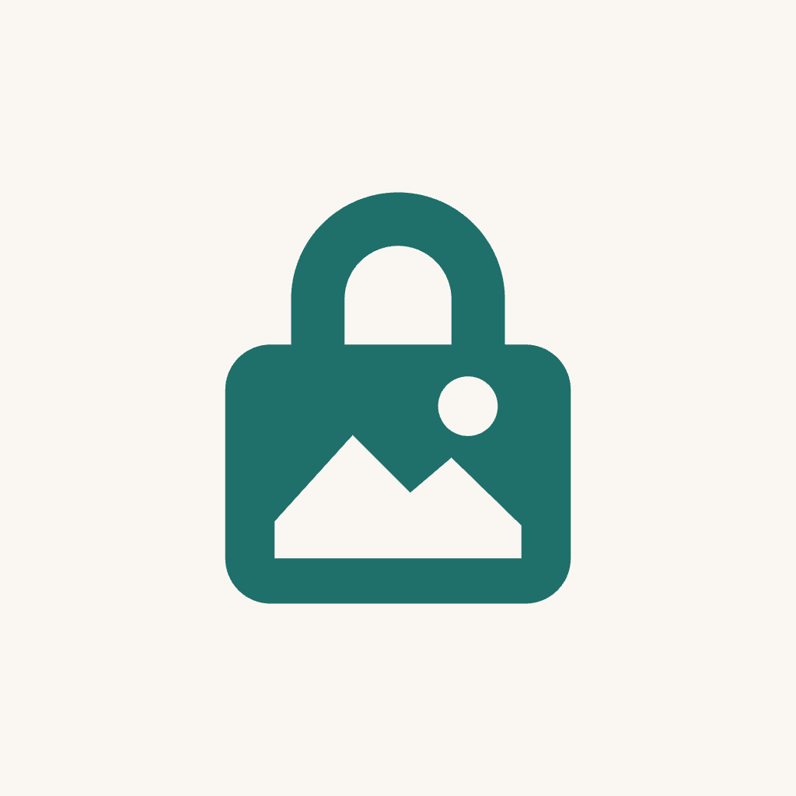
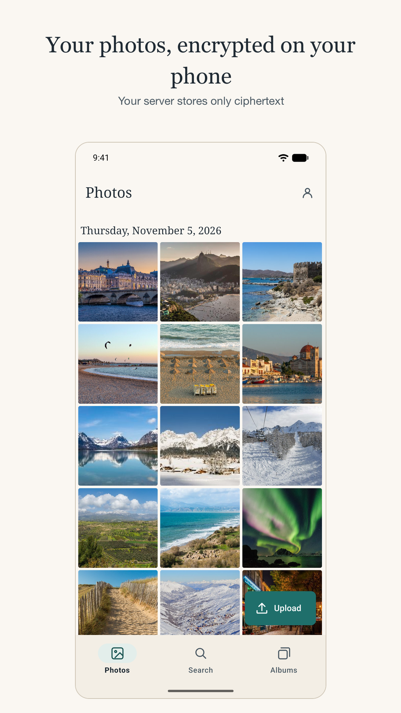
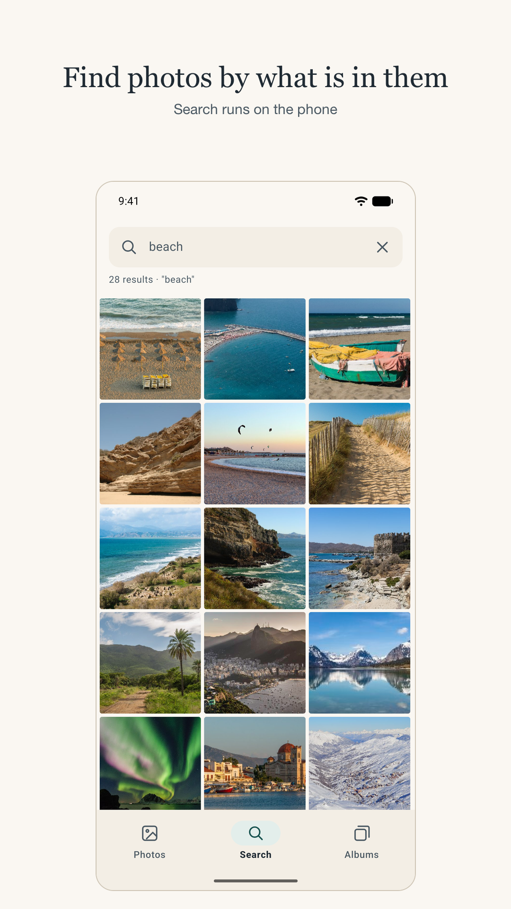
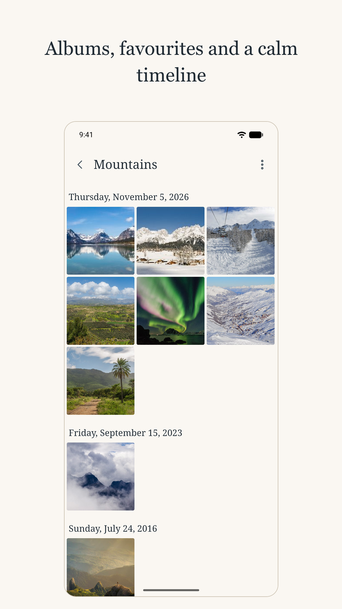
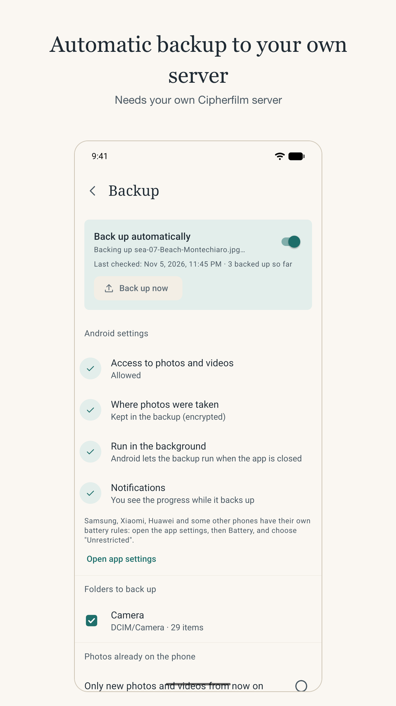

<p align="center">
  
</p>

<h1 align="center">Cipherfilm</h1>

<p align="center">
  <b>Your photo library on your own server, encrypted so that even the server can't look into it.</b>
</p>

<p align="center">
  <a href="https://github.com/basmatiactivist/cipherfilm/releases/latest"></a>
  <a href="LICENSE"></a>
  
  <a href="https://github.com/basmatiactivist/cipherfilm/actions/workflows/ci.yml"></a>
</p>

<p align="center">
  <a href="https://cipherfilm.app">Website</a> ·
  <a href="#try-the-demo"><b>Try the demo</b></a> ·
  <a href="docs/INSTALL.md">Install</a> ·
  <a href="docs/SELF-HOSTING.md">Self-hosting</a> ·
  <a href="docs/CRYPTO.md">How the encryption works</a> ·
  <a href="docs/THREAT_MODEL.md">Threat model</a>
</p>

<p align="center">
  
  
  
  
</p>

## What it is

Cipherfilm is a self-hosted photo and video library for a family and a few friends. Your phone, your Mac and your
browser encrypt every photo **before** it is uploaded. The server you run stores only ciphertext: it can't see your
pictures, file names, dates, places or album names, and neither can its administrator.

It does what you expect from a photo app: a timeline, albums, favorites, automatic backup from your phone, search by
what's in a picture ("beach", "dog") and by who is in it. Search and face recognition run on your own devices with
open models, and their results are stored encrypted too.

> **Know this first:** if someone loses *both* their password and their recovery key, their photos are lost.
> Nobody can reset it, not even the admin.

## Try the demo

Open **[demo.cipherfilm.app](https://demo.cipherfilm.app)**, or connect the Android or Mac app to that address, and sign
in with:

| E-mail | Password |
|---|---|
| `demo@cipherfilm.app` | `cipherfilm-demo` |

A shared, read-only account with sample photos (public domain): browse, search ("mountains", "beach") and see how it
feels. Uploads and changes are turned off, because everyone uses the same login, and visitors are signed out every
hour. To keep your own photos, [run your own server](#run-your-own-server).

## Features

- **End-to-end encrypted.** Photos, videos, thumbnails, names, capture dates, EXIF and albums are encrypted on the
  device with libsodium (XChaCha20-Poly1305, keys from Argon2id). Originals are kept byte for byte.
- **Automatic backup from Android.** New photos in the folders you choose are encrypted and uploaded in the background.
  The backup never holds your master key: it seals each new photo to your account's public key, so it can add photos
  but never read any.
- **Search and people, on your device.** Find photos by content and group faces into people, with open CLIP and face
  models that run locally ([docs/SEARCH.md](docs/SEARCH.md), [docs/MODELS.md](docs/MODELS.md)).
- **Free up space.** Remove photos from the phone once they are in Cipherfilm.
- **Locks itself.** Fingerprint unlock, automatic lock after a time you choose or when the screen turns off, and
  shake to lock and close.
- **Mac app.** Keeps an export folder up to date, uploads watched folders and indexes for search in the background
  ([docs/MAC.md](docs/MAC.md)).
- **Made for a small group.** Invite-only, a private library per person, storage limits, an admin area that never
  shows anyone's photos.
- **Light to run.** One Docker container with SQLite; about 35 MB of RAM when idle, fine on a 1–2 vCPU / 2 GB server.
- **Your data stays yours.** Plain backups with one script, and a standalone tool that decrypts everything from the
  data folder without the server ([docs/TOOLS.md](docs/TOOLS.md)).

## Get the apps

| | How | |
|---|---|---|
| **Android** | [Google Play](https://play.google.com/apps/testing/app.cipherfilm), closed test for now: join the [tester group](https://groups.google.com/g/cipherfilm-testers) first | |
| | [Obtainium](https://obtainium.imranr.dev/), installs and updates from the GitHub releases: add `https://github.com/basmatiactivist/cipherfilm` | recommended without Google |
| | APK from the [latest release](https://github.com/basmatiactivist/cipherfilm/releases/latest) | 64-bit ARM phones |
| **Mac** | from the [latest release](https://github.com/basmatiactivist/cipherfilm/releases/latest) | Apple silicon, macOS 15 or newer |
| **Web** | comes with your server, in any current browser | also iPhone and iPad |

Every app needs a Cipherfilm server, yours or someone else's. Step by step, with the APK's signing certificate:
[docs/INSTALL.md](docs/INSTALL.md).

## Run your own server

You need Docker with Compose and HTTPS. Three ways to get HTTPS are included: **Tailscale** (private, no open
ports), **your own reverse proxy**, or **bundled Caddy** with Let's Encrypt.

```bash
git clone https://github.com/basmatiactivist/cipherfilm && cd cipherfilm
cp .env.example .env              # choose the option with COMPOSE_FILE and fill in its settings
docker compose up -d --build      # or use the released image, see below
docker compose logs app | grep "FIRST-TIME SETUP"
```

Open the site, paste the one-time token, create the admin account and save the recovery key. Then invite people from
**Admin → Invite someone**. Instead of building, you can use the released multi-architecture image
`ghcr.io/basmatiactivist/cipherfilm:2`.

All options, backups, updates, settings and troubleshooting: **[docs/SELF-HOSTING.md](docs/SELF-HOSTING.md)**.

## How it works, briefly

```
your device                                          your server
───────────                                          ───────────
password ─Argon2id─► keys ─► master key (in memory)
photo ─► encrypt (XChaCha20-Poly1305, own key) ───► stores ciphertext + wrapped keys
search, faces ─► run locally ─► encrypted index ───► stores it, can't read it
```

Each item has its own key, wrapped by your master key. The server sees who has an account, how many items they have,
their sizes and upload times, and nothing of what they contain. The full design is in
[docs/CRYPTO.md](docs/CRYPTO.md). What the server still learns, and what a web app can't protect you from (whoever
controls the server could deliver modified JavaScript), is in [docs/THREAT_MODEL.md](docs/THREAT_MODEL.md).

## Honest limits

- Young software, written with the help of AI agents. Several rounds of AI-agent source audits found and fixed issues
  ([SECURITY.md](SECURITY.md)), but there has been **no independent human security review**.
- No two-factor sign-in yet, and no sharing between people.
- No server-side thumbnails or transcoding (the server can't see the content). iPhone HEVC videos don't play in every
  browser.
- Not tested at large scale (tens of thousands of photos).

Don't rely on it where losing or leaking the data would be catastrophic, and keep your own backups.

## Documentation

| | |
|---|---|
| [INSTALL.md](docs/INSTALL.md) | downloads for every platform |
| [SELF-HOSTING.md](docs/SELF-HOSTING.md) | deploy, back up, update, configure the server |
| [SERVER-COMMANDS.md](docs/SERVER-COMMANDS.md) | manage accounts from the command line |
| [TOOLS.md](docs/TOOLS.md) | bulk upload, decrypt without the app, run it on a Mac |
| [CRYPTO.md](docs/CRYPTO.md) · [THREAT_MODEL.md](docs/THREAT_MODEL.md) | the encryption and what it does and doesn't protect |
| [SEARCH.md](docs/SEARCH.md) · [MODELS.md](docs/MODELS.md) | on-device search and the models it uses |
| [MAC.md](docs/MAC.md) | the Mac app |
| [BACKUP-KOPIA.md](docs/BACKUP-KOPIA.md) | nightly off-site backups |
| [RELEASING.md](docs/RELEASING.md) | how releases are built and signed |

## Development

```bash
make up          # build and start at https://cipherfilm.orb.local (OrbStack)
make test        # Go and web unit tests (in Docker)
make e2e         # throwaway stack, Playwright browser tests, then a check that no plaintext reached the server
make prod-config # validate all production compose combinations
```

`server/` Go and SQLite (no CGO) · `web/` Preact, TypeScript, libsodium · `mobile/` Android (Expo, Kotlin) ·
`mac/` SwiftUI ([mac/README.md](mac/README.md)) · `tools/` upload and decrypt tools · `e2e/` Playwright ·
`deploy/` Tailscale, Caddy and local setups · `docs/` everything else. The original design is in [PLAN.md](PLAN.md).

Contributions are welcome: [CONTRIBUTING.md](CONTRIBUTING.md). Please report vulnerabilities privately, as described
in [SECURITY.md](SECURITY.md).

## License

[GNU Affero General Public License v3.0](LICENSE). If you run a modified version as a service, you must offer its
source to the users of that service.
